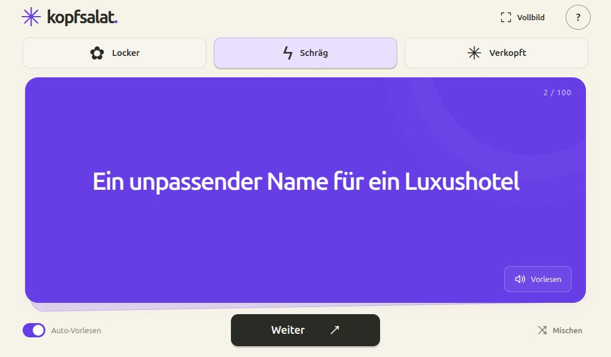

# kopfsalat.

Ein Partyspiel mit 900 Themen, drei Schwierigkeitsstufen und fertigen Dylan-Sprachaufnahmen aus lokalem Qwen3-TTS. Für einen gemeinsamen Bildschirm, besonders im Tablet-Querformat.



## Spielen

3–8 Personen, Papier und Stifte. Alle notieren heimlich vier unterschiedliche Antworten zum Thema. Jede eigene Antwort, die mindestens eine weitere Person ebenfalls hat, gibt einen Punkt – höchstens vier Punkte pro Person und Thema. Sinngleiche Begriffe zählen nach gemeinsamer Absprache. Nach zehn Themen gewinnt die höchste Punktzahl; bei Gleichstand gewinnt ihr gemeinsam. Empfohlen ab zehn Jahren.

- **Locker / Schräg / Verkopft:** jeweils 300 Themen, zufällig und ohne Wiederholung bis zum Stapelende.
- **Satzanfänge:** Bei „…“ schreibt jede Person vier unterschiedliche Ergänzungen auf; kurze Begriffe reichen. Über alle Kategorien verteilt gibt es 211 solcher Karten.
- **Weiter:** nächste Karte. **Vorlesen:** Dylan starten oder stoppen. **Auto-Vorlesen:** neue Karten automatisch vorlesen.
- **Mischen:** nur den aktuellen Stapel zurücksetzen.
- **Vollbild:** echtes Browser-Vollbild ein- und ausschalten. Escape beendet Vollbild auf dem Desktop. Browser ohne Vollbildunterstützung zeigen einen Hinweis.
- **?:** kurze Spielregeln.

Antworten und Punkte notiert ihr auf Papier. Fortschritt und Vorleseeinstellung bleiben im lokalen Browserspeicher. Gespeicherte Stapel aus der Version mit 100 Themen werden beim ersten Start neu gemischt; Kategorie und Vorleseeinstellung bleiben erhalten. Bei gesperrtem Speicher funktioniert das Spiel ohne dauerhafte Speicherung. Ton beginnt erst nach einer Interaktion.

## Lokal starten

```sh
python3 -m http.server 4173 --bind 127.0.0.1
```

Öffne [localhost:4173](http://127.0.0.1:4173). Alternativ: `npm run dev`. Das mitgelieferte `app.bundle.js` enthält alle Themen und die Spiellogik; es gibt beim Start keine weiteren Themenanfragen oder externen Schriftanfragen.

## GitHub Pages

1. Alle Quelldateien inklusive `app.bundle.js`, `assets/audio/` und `.github/workflows/pages.yml` in dein Repository hochladen.
2. **Settings → Pages → Source → GitHub Actions** auswählen.
3. Auf `main` pushen oder den Workflow **Deploy GitHub Pages** manuell starten.

Der Workflow prüft die Spiellogik und alle Audiodateien, erstellt `dist/` und veröffentlicht dieses Verzeichnis. Für einen anderen Branchnamen den Auslöser im Workflow anpassen. Alle Pfade sind relativ und funktionieren auch unter einem Repository-Unterpfad. Kein Backend, keine API-Schlüssel und kein KI-Dienst auf dem Gerät der Spielenden nötig.

Alternativ lässt sich das Hauptverzeichnis direkt mit **Deploy from a branch** veröffentlichen; dafür sind `.nojekyll` und das fertige Bundle enthalten.

## Entwicklung

Node.js ab 22 und Python 3, keine npm-Pakete nötig.

```sh
npm test
npm run check:audio
npm run build
```

Nach Änderungen an `app.js`, `game.js` oder `topics.json` **`npm run build`** ausführen. Das erzeugt `app.bundle.js` im Hauptverzeichnis und die fertige Website in `dist/`. Das Bundle mit ins Repository aufnehmen; `dist/` wird nicht eingecheckt.

| Datei | Zweck |
| --- | --- |
| `index.html`, `style.css` | Oberfläche |
| `app.js` | Bedienung, Vollbild und Wiedergabe |
| `game.js` | Stapellogik und Validierung |
| `topics.json` | 300 eindeutige Themen je Stufe mit stabilen IDs |
| `app.bundle.js` | Generiertes Startskript inklusive Themen |
| `assets/audio/` | Eine MP3 je Themen-ID |
| `scripts/`, `tests/` | Build, Audiowerkzeuge und Tests |

## Sprache neu erzeugen

Voraussetzungen: Linux, Python 3, FFmpeg und lokales Qwen3-TTS auf Port 8880 mit Stimme `dylan`.

```sh
python3 scripts/generate_audio.py            # Fehlende Dateien ergänzen
python3 scripts/generate_audio.py --limit 3  # Kleine Stichprobe
python3 scripts/generate_audio.py --force    # Alle neu erzeugen
```

Ein anderer Dienstpfad lässt sich mit `--endpoint URL` setzen. Die Erzeugung läuft nacheinander, wiederholt fehlgeschlagene Anfragen und normalisiert die MP3-Dateien auf −16 LUFS. Satzanfänge werden mit „Ergänze den Satz“ angekündigt. Textänderungen brauchen neue Aufnahmen. Vorhandene Dateien werden ohne `--force` übersprungen. `npm run check:audio` prüft die Vollständigkeit, nicht die Aussprachequalität.

## Bedienung und Datenschutz

Pfeil rechts zieht das nächste Thema. Alle Tasten sind per Tastatur bedienbar; Dialoge schließen mit Escape. Animationen berücksichtigen die Systemeinstellung für reduzierte Bewegung. Es gibt keine Konten, Analyse-Tools, externen Schriften oder Erfassung der Antworten. Alle Laufzeitdateien kommen vom eigenen Hosting. Aktuelle Browser mit HTML-Audio und `<dialog>` werden vorausgesetzt. Vollbild hängt von der Unterstützung des Browsers ab.

## Lizenz

Quellcode, Themen, SVG-Symbol und mitgelieferte Sprachaufnahmen: [MIT](LICENSE). Die lokale KI-Modellsoftware wird nicht mitgeliefert.
